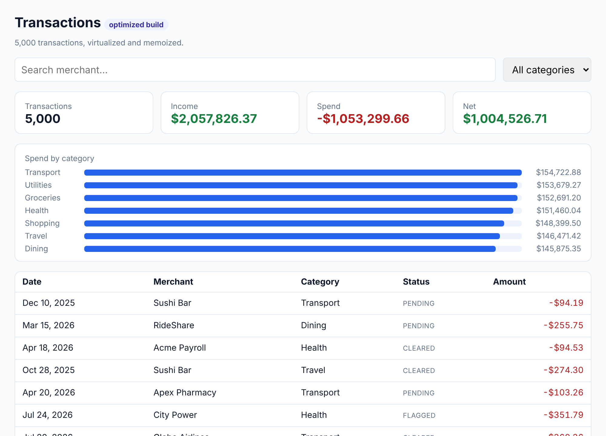

# Frontend Performance Lab

The same transactions dashboard — 5,000 rows, search, category filter, summary and a breakdown — built **twice**: once naively, once optimized. Identical features and UI; the only difference is engineering. The point is to show optimization work backed by **reproducible measurements**, not adjectives.



## Measured results

Median of 5 Lighthouse runs, mobile profile (4× CPU throttle, Slow 4G), against the production builds. Reproduce with `pnpm build && pnpm measure`; raw output is in [`benchmarks/`](benchmarks).

| Metric                      |    Naive | Optimized | Improvement |
| --------------------------- | -------: | --------: | ----------: |
| Performance score           |       82 |        95 |     +13 pts |
| Largest Contentful Paint    |   2.40 s |    1.85 s |   23% lower |
| Total Blocking Time         |   0.51 s |    0.00 s |  100% lower |
| Speed Index                 |   2.40 s |    1.75 s |   27% lower |
| First Contentful Paint      |   2.40 s |    1.75 s |   27% lower |
| Initial JS (uncompressed)   | 275.8 kB |  145.0 kB | 47% smaller |
| JS transferred (Lighthouse) | 276.1 kB |  146.5 kB | 47% smaller |

Headline: a Lighthouse performance score of **82 → 95**, with total blocking time eliminated and roughly half the JavaScript shipped. The blocking-time win comes from not putting 5,000 rows (and `moment`-formatted dates for each) on the main thread; the bundle win comes from dropping `moment` and `lodash` for native APIs.

## What differs between the two builds

See [docs/techniques.md](docs/techniques.md) for the full table mapping each technique to the metric it moves. In short, the optimized build adds: list virtualization, `useMemo` for derived data, `useDeferredValue` for search, `memo` on the table, code-splitting for the breakdown widget, and native `Intl` formatting instead of `moment`/`lodash`.

## Run it

```bash
pnpm install
pnpm dev:slow                 # http://localhost:5173 — open /slow.html and /fast.html
pnpm lint && pnpm typecheck && pnpm test && pnpm build
pnpm measure                  # rebuilds numbers in benchmarks/ (needs Chrome; set CHROME_PATH)
pnpm analyze                  # writes benchmarks/bundle-report.html (treemap)
```

`pnpm measure` looks for Chrome at `CHROME_PATH`, falling back to a local Chromium path. Any Chrome/Chromium works.

## Methodology and honesty

- **Seeded data** (`src/shared/data.ts`) so both builds do identical work and runs are repeatable.
- **Median of N runs**, not a single sample; lab numbers still vary by machine, so treat the _deltas_ as the result, not the absolute scores.
- Numbers in this README were generated by the committed script on the CI-class Linux container used to build the repo. On your hardware the absolute scores will differ; the relative improvement is the reproducible part.
- CI runs lint, typecheck, tests and build. It does **not** run Lighthouse: headless perf numbers are too machine-dependent to gate a build on. Measurement is a deliberate, local step.

## Limitations

- One dataset size (5,000 rows) and one device profile. A fuller study would sweep sizes and add a desktop profile.
- No real backend or network variability; data is generated in the browser.
- Virtualization here is fixed-row-height and intentionally minimal to show the mechanism; production would use a maintained library for variable heights and accessibility edge cases.
- This measures load and interaction cost of one screen, not a full app's runtime profile.

## License

MIT
